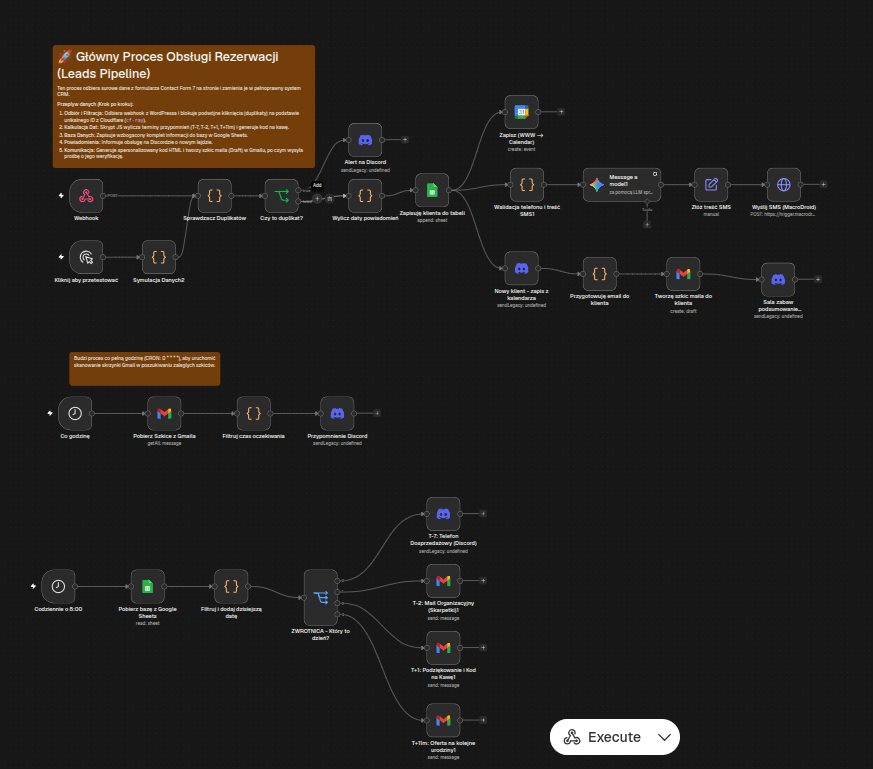

# 🎈 n8n Event Booking & Communication Lifecycle Automation

> Kompleksowy system automatyzacji obsługi klienta i rezerwacji eventowych (sala zabaw / urodziny) zbudowany w **n8n**, integrujący formularze Webhook, Google Calendar, dynamiczne generowanie HTML, harmonogramowanie follow-upów oraz powiadomienia Discord.

---

## 🎯 Problem biznesowy
Przy obsłudze rezerwacji eventowych (np. przyjęcia urodzinowe) kluczowe jest natychmiastowe potwierdzenie, personalizacja komunikacji zależna od płci dziecka, precyzyjne harmonogramowanie wiadomości przed i po evencie (T-7 dni, T-2 dni, badanie satysfakcji, ponowienie oferty za rok) oraz powiadamianie obsługi obiektu bez konieczności ciągłego sprawdzania maila.

## 💡 Rozwiązanie
Workflow realizuje pełny cykl życia rezerwacji (Lifecycle Marketing & Operations):
1. **Przyjęcie zgłoszenia:** Webhook z formularza www przyjmuje dane zamówienia (pakiet, data, dodatki, dane solenizanta).
2. **Zaawansowana logika biznesowa (JavaScript Code Node):**
   - **Algorytm detekcji płci solenizanta:** Analiza imienia z uwzględnieniem wyjątków języka polskiego (np. Kuba, Kosma, Barnaba), pozwalająca na gramatycznie poprawną odmianę zwrotów (`syna / córki`, `Solenizanta / Solenizantki`).
   - **Dynamiczne generowanie harmonogramu powiadomień:** Automatyczne wyliczenie dat etapowych:
     - `T-7 dni` – mail organizacyjny z dopięciem menu i liczby gości,
     - `T-2 dni` – przypomnienie SMS/email przed samym wydarzeniem,
     - `T+1 dzień` – ankieta satysfakcji i prośba o opinię w Google,
     - `T+11 miesięcy` – reaktywacja klienta ze zniżką na kolejne urodziny.
3. **Generowanie szkicu wiadomości (HTML Draft):**
   - Złożenie spersonalizowanego maila HTML i zapisanie go jako wersja robocza w Gmail do szybkiej weryfikacji i wysyłki przez obsługę.
4. **Kanał powiadomień operacyjnych:**
   - Natychmiastowy alert na Discord dla zespołu z kompletem szczegółów zamówienia i linkiem do akceptacji draftu.
5. **Synchronizacja bazy i kalendarza:**
   - Zapis do Google Sheets z unikalnym ID zapytania (`cf-ray`).
   - Obsługa równoległego triggera z Google Calendar do potwierdzania statusów na osi czasu.

---

## 🛠️ Stack technologiczny
- **Narzędzie:** n8n
- **Integracje:** Webhook, Gmail (Drafts & Messages), Google Calendar, Google Sheets, Discord Webhooks
- **Język:** JavaScript / Node.js (przetwarzanie dat, regex, odmiana gramatyczna)

---

## 🚀 Jak uruchomić u siebie
1. Zaimportuj plik `.json` do instancji n8n.
2. Podepnij webhook pod swój formularz rezerwacyjny (np. Elementor, Contact Form 7, Typeform).
3. Dodaj uprawnienia do konta Google (Gmail, Sheets, Calendar) oraz webhook Discorda.
4. Dostosuj szablony HTML maili pod swoją markę.
