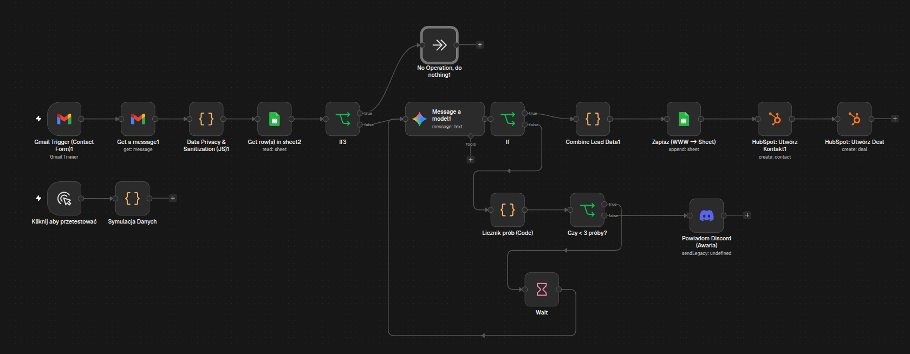

# 🤖 n8n AI Lead Qualification Agent

> Produkcyjny workflow w **n8n** integrujący skrzynkę pocztową, modele LLM (Google Gemini / OpenAI), arkusze Google Sheets oraz HubSpot CRM z wbudowaną architekturą bezpieczeństwa i obsługą błędów.



---

## 🎯 Problem biznesowy
Ręczna kwalifikacja zapytań ofertowych spływających przez formularze www jest czasochłonna, podatna na błędy i spowalnia czas pierwszej reakcji do klienta (First Response Time). Ponadto przesyłanie surowych danych bezpośrednio do zewnętrznych LLM niesie ze sobą ryzyko ataków typu *Prompt Injection* oraz niepotrzebnego wycieku wrażliwych danych kontaktowych.

## 💡 Rozwiązanie
Zbudowany pipeline działa w pełni autonomicznie w tle:
1. **Odbiór zgłoszenia:** Trigger Gmail nasłuchuje na nowe wiadomości z formularza kontaktowego.
2. **Data Privacy & Sanitization (Node JS):** 
   - Oddzielenie danych osobowych (imię, telefon, e-mail) od treści pytania przekazywanego do modelu AI.
   - Ochrona przed atakami typu Prompt Injection (blokowanie fraz typu `ignore previous instructions`, `system prompt`).
   - Normalizacja numerów telefonów (format E.164 / +48).
3. **Analiza LLM (Structured Output):**
   - Model językowy (Gemini 3.5 Flash / OpenAI) analizuje intencję klienta (`wycena`, `wsparcie`, `spam`), szacuje budżet, ocenia sentyment i przygotowuje gotowy szkic odpowiedzi wg bazy wiedzy firmy.
   - Wymuszenie ścisłego formatu JSON (brak halucynacji formatowania).
4. **Zapis i synchronizacja:**
   - Logowanie zgłoszenia do bazy w Google Sheets (z kontrolą duplikatów po ID).
   - Automatyczne utworzenie kontaktu oraz transakcji (Deal) w HubSpot CRM ze sformatowanym podsumowaniem AI.
5. **Mechanizm odporności na awarie (Fault Tolerance):**
   - Weryfikacja poprawności odpowiedzi AI.
   - Pętla ponawiania z licznikiem (do 3 prób) z odstępem czasowym.
   - Kanał typu Dead-Letter: powiadomienie na kanale Discord w przypadku trwałej awarii API modelu.

---

## 🛠️ Stack technologiczny
- **Orkiestracja:** n8n (Code Nodes, Logic Flow, Loops, Error Handling)
- **Modele LLM:** Google Gemini Flash / OpenAI API (Structured JSON Prompting)
- **Integracje API:** Gmail API, Google Sheets API, HubSpot CRM REST API, Discord Webhooks
- **Język skryptowy:** JavaScript (Node.js) wewnątrz węzłów n8n

---

## 📋 Struktura zwracanego obiektu JSON z LLM
```json
{
  "intencja": "wycena | wsparcie_techniczne | oferta_pracy | spam | inne",
  "temat_glowny": "Krótkie podsumowanie problemu (max 6 słów)",
  "szacowany_budzet": "Wykryta kwota lub 'nieokreślony'",
  "sentyment": "pozytywny | neutralny | negatywny",
  "kluczowe_pytania": ["Lista konkretnych wymagań klienta"],
  "propozycja_odpowiedzi": "Gotowy szkic wiadomości e-mail"
}
```

---

## 🚀 Jak uruchomić u siebie
1. Zaimportuj plik `.json` do swojej instancji n8n.
2. Skonfiguruj poświadczenia (Credentials) dla:
   - Gmail OAuth2
   - Google Gemini API / OpenAI API
   - Google Sheets OAuth2
   - HubSpot App Token
   - Discord Webhook
3. Zaktualizuj ID arkusza Google Sheets oraz Pipeline ID w HubSpot.
4. Aktywuj workflow.
